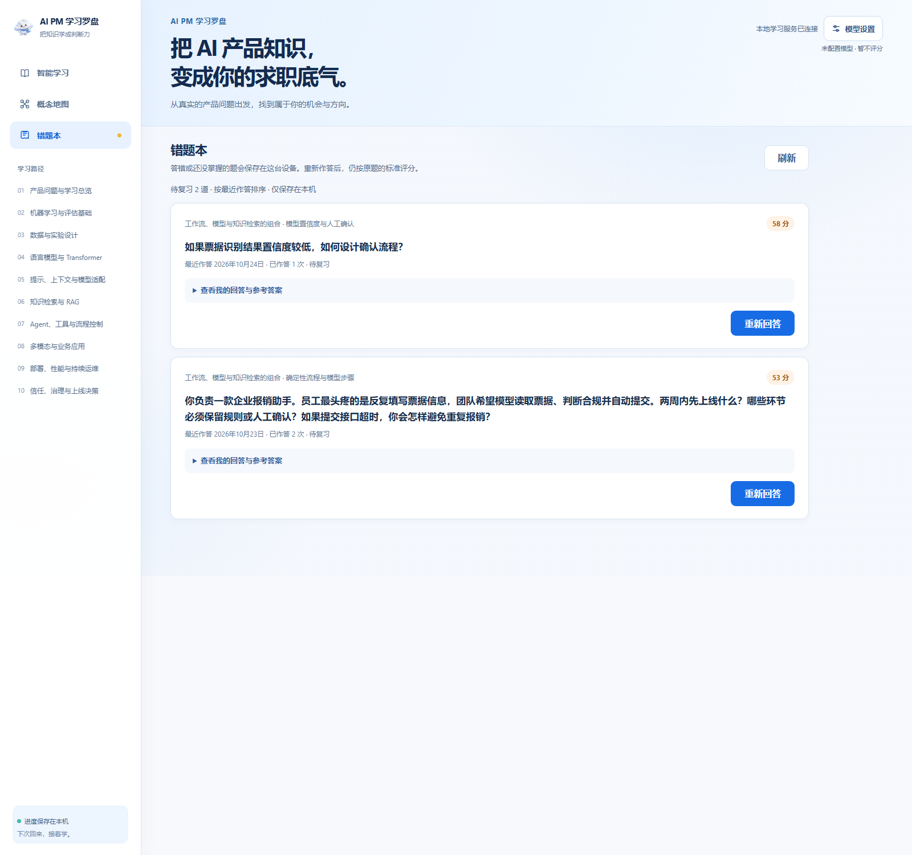
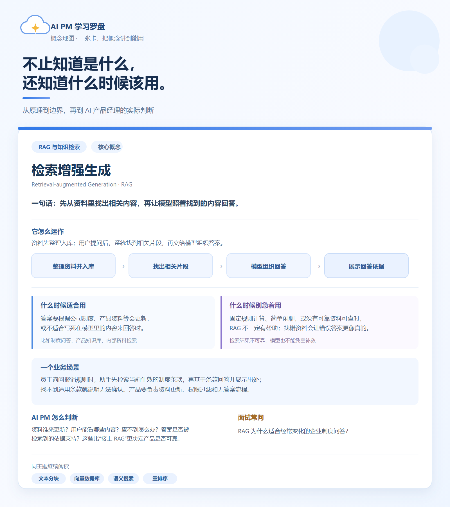

  

<h1 align="center">AI PM 学习罗盘</h1>

  把 AI 产品知识，变成求职时的判断力。 
  一款面向 AI 产品经理学习者的 Windows 桌面学习工具

  <a href="https://github.com/twosstar/ai-pm-learning-compass/releases/tag/v2.0.0">下载 V2.0 Windows 安装包</a>
  · 60 节课程 · 120 个知识点 · 150 张概念卡

## 页面预览

从课程学习、场景作答到反馈复盘，主要页面一览。截图采用公开课程和临时演示数据。

<table>
  <tr>
    <td width="50%"><strong>学习首页</strong> </td>
    <td width="50%"><strong>场景练习</strong> </td>
  </tr>
  <tr>
    <td width="50%"><strong>答题反馈</strong> </td>
    <td width="50%"><strong>概念地图</strong> </td>
  </tr>
  <tr>
    <td width="50%"><strong>错题本</strong> </td>
    <td width="50%"></td>
  </tr>
</table>

## 一张完整的知识卡片

概念卡会把定义、工作方式、适用场景、使用边界和产品经理的判断放在一起，帮助初学者知道概念怎么用、何时不该用。

  

## 你可以用它做什么

- **沿学习路径入门：** 10 个主题模块、60 节课程、120 个知识点。
- **练习求职场景：** 用 AI 产品业务题练需求判断、技术取舍和风险处理。
- **复盘回答：** 查看评分、答题亮点、待补充内容和参考表达；重新评价会保留原回答。
- **整理错题：** 保存题目、个人回答、参考答案和评分，随时重新作答。
- **查阅概念地图：** 按主题浏览 150 张概念卡，了解适用条件与容易误用的地方。
- **接着上次学习：** 阅读位置和练习进度保存在当前电脑，不需要创建账号。

## 安装

1. 打开 [V2.0 下载页](https://github.com/twosstar/ai-pm-learning-compass/releases/tag/v2.0.0)。
2. 下载 `AI-PM-Learning-Compass-Setup-2.0.0.exe` 并按提示安装。
3. 从桌面或开始菜单打开“AI PM 学习罗盘”。无需安装 Python 或购买服务器；电脑需要 Microsoft Edge WebView2 Runtime。

首次安装会从空白进度开始，不包含开发者的学习记录或模型密钥。正式版本发布后，应用会检查更新并提示安装。

## AI 评分与数据

评分需要在应用内配置自己信任的模型服务商、模型名称和 API 密钥；调用费用由使用者承担。练习或评分时，题目、相关课程内容及回答会发送给所选服务商。

学习记录保存在本机。API 密钥可只在本次运行中使用，也可保存到当前 Windows 用户的凭据保险库。请勿把密钥提交到仓库。

## 课程与资料

课程和概念卡为本项目独立整理编写，不收录课程原始视频、讲义、逐字稿或专有题库。参考资料范围见[课程来源说明](CURRICULUM_SOURCES.md)。
