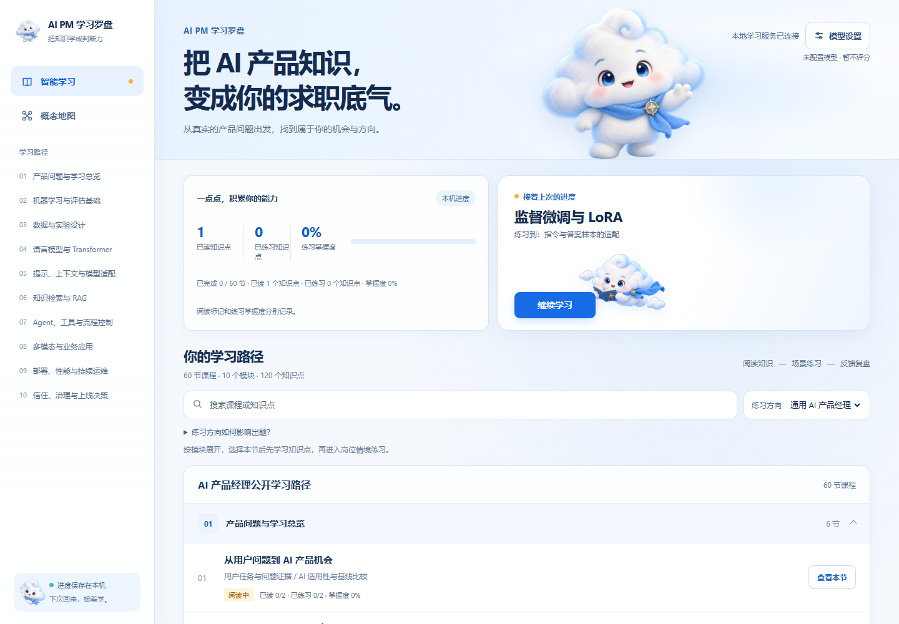
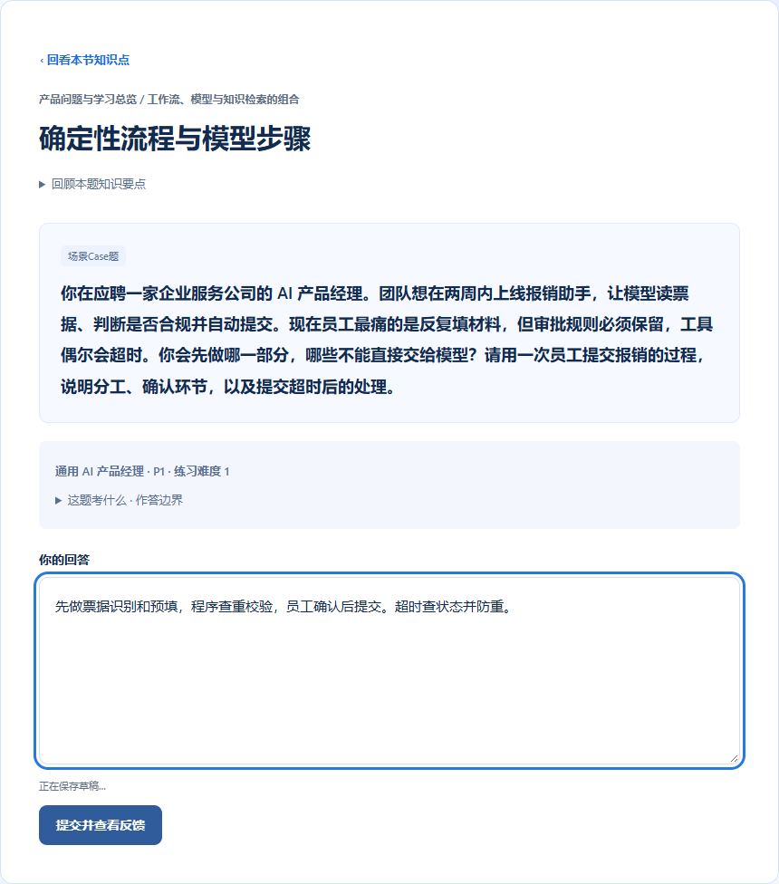
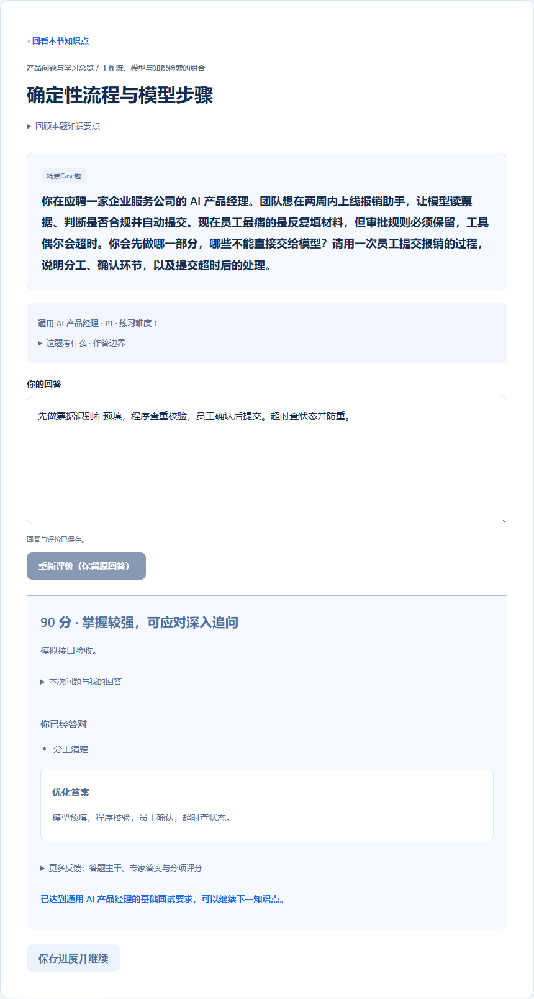
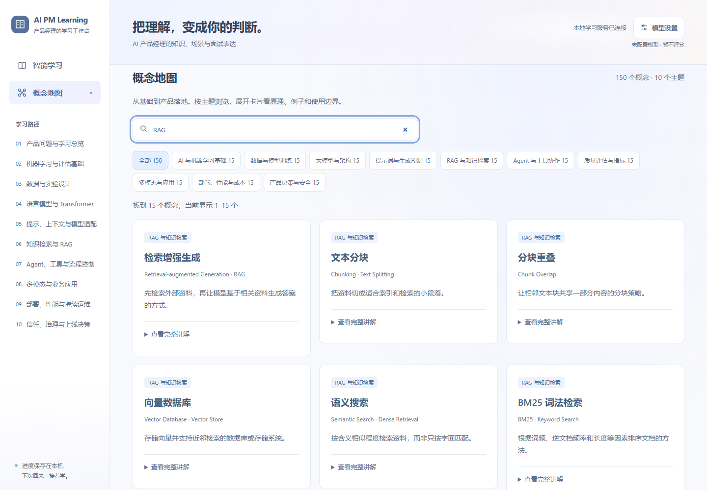

# AI 产品经理学习罗盘

**AI PM Learning Compass · 中文优先 · 本地运行 · 面向求职实践**

[English README](README.en.md) · [中英文项目介绍](docs/PROJECT_INTRO.zh-CN.md) · [Project introduction](docs/PROJECT_INTRO.en.md) · [发布素材](docs/LAUNCH_KIT.md)

把 AI 产品知识放进真实业务场景里学：先理解概念，再练习做判断，最后看清自己的回答哪里扎实、哪里还需要补充。

## 产品页面

以下截图来自临时演示数据。评分页使用模拟评价结果，不含私人学习记录、真实作答或 API 密钥。

| 学习首页 | 面试场景练习 |
|---|---|
|  |  |
| **评分与改进反馈** | **概念地图** |
|  |  |

## 你可以用它做什么

- **沿学习路径系统学习：** 60 节课、10 个模块、120 个知识点；阅读和练习进度保存在本机，下次可以接着学。
- **练习求职场景：** 围绕 AI 产品工作中的真实取舍组织练习，可选择通用 AI 产品经理或 AI+教育方向。
- **获得可读的答题反馈：** 查看回答中的有效判断、关键缺口、分项评价和参考表达。模型服务不可用时，答案会标为“待评价”，不会编造分数。
- **用概念地图查漏补缺：** 150 张概念卡按主题整理，支持中英文搜索；浏览概念不调用模型 API。

这是一个独立编写的公开学习项目，不是付费课程的复刻。课程正文、示例和练习均为本项目整理或原创；不包含课程视频、讲义、逐字稿、专有题库、私人数据库或原应用学习记录。来源范围与限制见 [课程来源说明](CURRICULUM_SOURCES.md)。

## 在 Windows 上运行

### 普通用户：安装桌面版

正式版发布后，可在 [GitHub Releases](https://github.com/twosstar/ai-pm-learning-compass/releases) 下载最新的 `AI-PM-Learning-Compass-Setup-X.Y.Z.exe`，双击后按向导安装。安装无需 Python 或管理员权限；需要 Microsoft Edge WebView2 Runtime。若安装器提示缺少运行时，按提示打开微软页面安装后再运行安装包。当前测试版尚未签名，Windows 可能显示“未知发布者”提示。

首次安装会创建空白的本机学习记录，不会附带开发者的学习进度或模型密钥。学习数据保存在 `%LOCALAPPDATA%\AI PM Learning Compass\data`；模型服务偏好保存在 `%LOCALAPPDATA%\AI PM Learning Compass\config`。密钥默认只在本次运行中使用；勾选“记住此设备”后，密钥保存在当前 Windows 用户的凭据保险库。更新和卸载都会保留学习数据与已保存配置。

应用启动时会检查正式版本，并在打开期间每 6 小时再检查一次。下载完成并校验后，应用会询问是否“安装并重启”；安装过程可见，用户可以稍后再装。应用关闭时不会在后台检查，也不会强制更新。

### 开发者：从源码运行

需要 **Python 3.11 或更新版本**。

1. 下载或克隆本仓库。
2. 双击 `Start Learning Copilot.bat`；首次启动会创建本地环境并安装依赖，需要联网等待几分钟。
3. 浏览器打开后即可阅读课程和浏览概念地图。保持启动窗口开启；按 `Ctrl+C` 停止服务。

应用默认在 [http://127.0.0.1:8001/](http://127.0.0.1:8001/) 提供服务。若只想阅读和体验界面，不需要配置模型。

### 启用 AI 评分

在页面顶部打开“模型设置”，填写你信任的服务商所提供的 HTTPS、OpenAI 兼容 API 地址、模型名称和你自己的 API 密钥，确认数据传输与费用提示后保存。保存时不会发起模型请求；首次练习或重新评价待评价答案时才会调用服务商。

密钥默认只保存在本地服务进程内。桌面版可选择保存到当前 Windows 用户的凭据保险库；API 密钥不会写入普通配置文件、学习数据库或浏览器存储。练习和评分可能把题目、课程片段及回答发送给所选服务商并产生费用。请勿把密钥发到聊天或提交到仓库。此版本面向可信的个人本机使用，不适合直接部署为公网多用户服务。

## 本地数据与公开内容

学习进度、草稿和答题记录默认保存在本机 SQLite 数据库，不提供账号系统或云同步。公开课程数据位于 `app/data/public_curriculum.json`，150 张概念卡的权威内容位于 `app/data/concept_library.json`。课程检查器可检查结构和来源元数据，但不替代人工事实核对，也不构成版权许可结论。

更多技术细节见 [课程来源说明](CURRICULUM_SOURCES.md)、[发布检查清单](RELEASE_CHECKLIST.md)、[隐私与发布审计](docs/RELEASE_AUDIT.md) 和 [发布素材说明](docs/LAUNCH_KIT.md)。软件许可证尚未确定；在所有权和依赖条款确认前，请勿假设本项目可自由复用。
