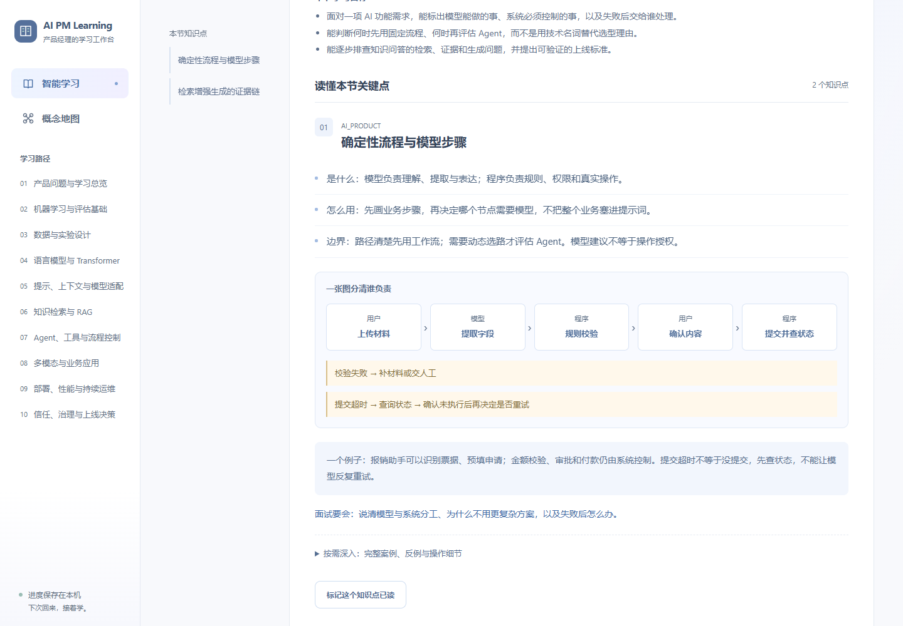
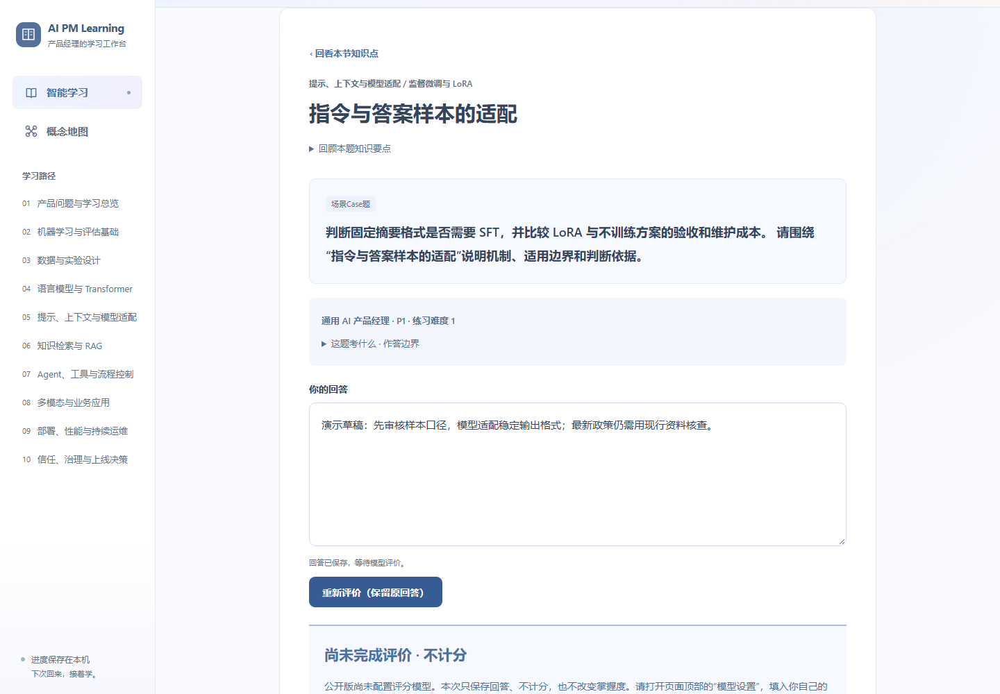
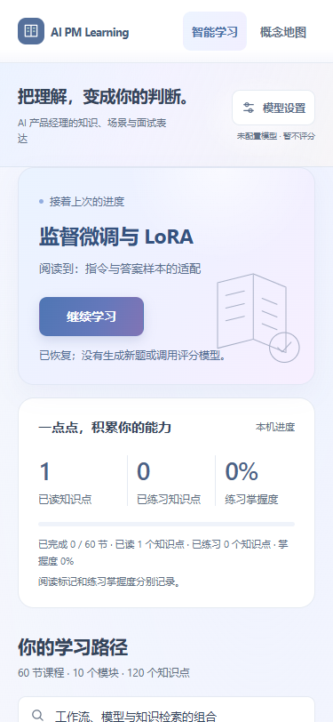

# AI PM Learning Copilot

## 把知识学会，再走向下一步。

面向 AI 产品经理学习者与求职者的本地学习工作台：沿着系统化课程理解知识，在产品场景中练习表达，通过反馈发现缺口，下次回来继续上次的进度。

**60 节课程 · 120 个固定知识点 · 150 张概念卡片 · 本地保存进度 · 自带模型配置**

[English introduction](PROJECT_INTRO.en.md) · [安装与维护说明](../README.md) · [发布素材与配图指南](LAUNCH_KIT.md)

*图示为独立临时环境中的演示数据。已读、已练习与掌握度分别显示，不用虚构的学习成绩装饰页面。*

## 为什么做这个项目

学习 AI 产品经理，常见的困难不是找不到资料，而是资料分散、概念看懂了却不知道怎么用、做过一道题却不清楚缺在哪里，以及隔几天回来忘记学到哪里。

AI PM Learning Copilot 把这些环节组织在同一个工作台里。它不是一个只负责给答案的聊天框，也不是把课程目录堆在页面上。它希望帮助学习者从“认识一个术语”，走到“知道适用边界，能在具体业务里作出判断，并解释自己的取舍”。

项目优先服务求职学习场景，但不承诺就业结果，也不把一次模型评分当作能力认证。

## 适合谁

- 希望系统建立 AI 产品知识框架，而不只记住 RAG、Agent、LoRA 等名词的入门学习者。
- 正在准备 AI 产品经理面试，需要练习场景分析、技术选型和表达结构的求职者。
- 从传统产品工作转向 AI 产品，希望理解数据、模型、评估与上线约束的产品经理。
- 希望在自己的电脑上运行、修改课程内容，并自行选择模型供应商的学习者与开发者。

当前界面和教学内容以中文为主；英文项目介绍不代表已提供完整英文课程或英文界面。

## 一个完整的学习闭环

**选课 → 学知识点 → 看场景与边界 → 回答问题 → 查看反馈 → 保存进度 → 继续下一步。**

### 1. 先建立框架，再逐节深入

公开学习路径包含 10 个模块、60 节课程、120 个固定知识点：

| 模块 | 重点 |
|---|---|
| 产品问题与学习总览 | 用户问题、竞品分析、目标约束、验收指标 |
| 机器学习与评估基础 | 学习任务、分类回归、误报漏报、泛化与选型 |
| 数据与实验设计 | 数据划分、泄漏、标注质量、漂移与可复现实验 |
| 语言模型与 Transformer | token、向量、预训练、注意力、结构与采样 |
| 提示、上下文与模型适配 | 提示设计、结构化结果、微调、LoRA 与偏好训练 |
| 知识检索与 RAG | 入库分块、词法与向量召回、重排、引用与评估 |
| Agent、工具与流程控制 | 工作流、工具契约、状态记忆、权限与失败恢复 |
| 视觉、语音与其他任务 | 视觉识别、语音、图文、推荐与信息抽取 |
| 推理与部署优化 | 时延吞吐、缓存、量化蒸馏、资源、发布与成本 |
| 产品体验、安全与综合实战 | 首次使用、解释反馈、数据边界、人工控制与发布论证 |

课程支持按模块展开、关键词搜索。稳定的课程和知识点 ID 让内容迭代与学习记录可以分别维护。

### 2. 默认精简，细节按需展开

所有知识点使用统一的教学结构：

- **是什么**：先用清楚的话解释概念。
- **怎么用**：给出产品工作中的使用方法。
- **应用边界**：明确它不能解决什么，什么时候不适合使用。
- **判断路径图**：用步骤与失败分支呈现关键关系。
- **短案例与面试要求**：把知识连接到实际判断与表达。
- **按需深入**：展开查看原理、反例、操作步骤与更完整的讲解。

默认必读文字设有长度限制；长篇解释不会全部挤在首屏。流程图是围绕每个知识点编写的判断或应用路径，不是把所有技术都描述成同一条算法流水线。

### 3. 在产品场景里练习，而不是只复述定义

练习鼓励说明目标、约束、方案、取舍和失败处理。例如：哪些步骤适合交给模型，哪些必须交给程序；工具超时后为什么不能盲目重试；引用存在为什么仍可能答错。

支持“通用 AI 产品经理”与“AI＋教育产品经理”就业方向。当前第二节具备两套方向、不同阶段的精编案例；其他课程保留现有生成或备用题目机制，尚未全部拥有同等深度的双方向精编题库。

### 4. 反馈帮助你改进表达，模型不可用时不编分数

配置可用的兼容模型后，可以提交回答，查看已答对的内容、优先补充的缺口、优化表达与分项反馈。当前评价维度包括概念准确、机制理解、产品判断、场景应用和表达结构。

模型未配置、认证失败、额度受限或返回格式不兼容时，系统保存回答并显示“尚未完成评价，不计分”。它不会把备用参考答案包装成你的个性化评价，也不会用答案长度随意生成一个分数。

修正配置后，可重新评价原先尚未评分的回答。已正式保存的评价不会因为恢复页面而被重复评分。

*此图展示离线状态，不是模型真实评分示例。AI 评价用于练习参考，不是面试通过或专业能力认证。*

### 5. 每次回来，都接着往前

首页显示上次课程与知识点，提供“继续学习”。课程目录区分未开始、阅读中、练习中和已完成学习流程，并分别显示已读、已练习和掌握度。

阅读位置、显式已读标记、练习会话与草稿保存在本机数据库。刷新或关闭浏览器后再次进入，可以恢复原题和回答，不必为了找回进度重新生成一道题。

“已读”是你主动设置的阅读标记，不等于掌握；完成学习流程也不代表所有能力已经达标。过去没有记录的阅读位置不会被系统凭空补出来。

### 6. 随时查阅 150 张概念卡片

概念地图覆盖 10 个主题，支持中英文名称、缩写搜索、主题筛选、分页、例子、使用边界和相关概念导航。它是一个可检索的概念卡片库，并非交互式节点连线图。

这 150 个概念是面向 AI 产品学习的编辑选集，不是任何机构认定的“唯一必备清单”。浏览课程和概念卡片不需要调用模型。

## 本地运行，自行选择模型

1. 安装 Python 3.11 或更新版本。
2. 在 Windows 上双击项目根目录的 `Start Learning Copilot.bat`。首次启动会创建环境并安装依赖，需要网络和一定等待时间。
3. 保持启动窗口打开，在浏览器访问 `http://127.0.0.1:8001/`。
4. 不配置模型也能阅读课程、查概念、保存阅读位置和草稿。需要模型评价时，点击顶部“模型设置”。
5. 填入可信供应商的 HTTPS OpenAI 兼容聊天接口地址、准确模型名称和自己的密钥，确认数据发送及费用提示后保存。

保存配置本身不调用供应商，也不证明连接有效。开始练习与提交评价可能调用供应商并产生费用。兼容性取决于供应商、模型与结构化返回能力，不能保证所有“兼容接口”都适用。

## 数据与内容边界

- 页面输入的密钥只保存在本次本机服务进程中；应用不把它写入项目文件、学习数据库或浏览器持久存储。关闭服务后需重新填写；已发出的请求可能在清除配置后继续完成。
- 学习记录和草稿位于本机数据库。它们不属于公开发布素材，不应随仓库上传。浏览器刷新不会删除数据库，但删除本地数据、重装到不同目录或更换电脑也不等于自动迁移。
- 开启模型后，相关教学片段、问题和回答可能发送给你选择的供应商；“本地保存”不表示模型推理也完全离线。
- 当前是可信本机上的单学习者应用，不是已具备账户隔离、云同步和公网密钥托管的多用户 SaaS。请勿直接把本地服务暴露到公网。
- 公开版使用独立编排的目录与原创教学整理，保留公开资料的来源元数据；不随项目分发购买课程的视频、PPT、讲义、原文、商业题库或书籍全文。
- 来源链接用于查阅和维护，不等于取得原文再分发许可。自动检查能发现部分发布风险，但不能替代人工事实核查、权利审查或专业判断。

## 给内容维护者与开发者

前端采用 HTML、CSS 和 JavaScript，后端采用 FastAPI，学习记录通过 SQLAlchemy 保存至本地 SQLite。课程、概念和教学覆盖层使用可编辑的 JSON 文件；阅读页面不依赖在线生成正文。

- `app/data/public_curriculum.json`：基础课程结构、正文与来源。
- `app/data/teaching/M01.json` 至 `M10.json`：逐知识点的精简讲法、边界、流程与反例。
- `app/data/lesson102_teaching.json`：第二节的精编教学覆盖层。
- `app/data/concept_library.json`：概念卡片。
- `tests/` 与 `scripts/`：课程检查、发布检查与自动化验证。

修改内容时保留既有 ID，先检查再重启。学习数据库、备份、环境文件和日志应保持私有。代码与第三方依赖的使用范围以最终发布时的许可证及相关条款为准；当前仓库尚未选定项目许可证。

## 当前范围与后续方向

当前聚焦智能学习和概念地图。课程采集、浏览器控制、付费资料导入等私人功能不在公开 HTTP 功能范围内。桌面安装包、完整英文界面、多人账户和云端跨设备同步尚未交付，不能按已实现能力宣传。

欢迎围绕内容准确性、教学可读性、案例质量、恢复体验和供应商兼容性提出可复现反馈。后续改进仍以“理解后能用、练习后知道怎么改”为核心，而不是单纯增加术语数量。

*手机截图展示响应式网页，不代表已发布原生手机 App。*
